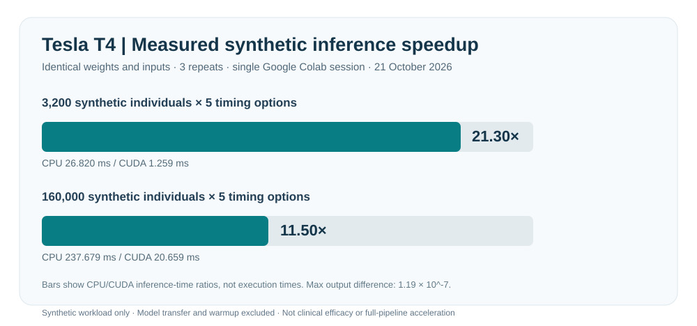
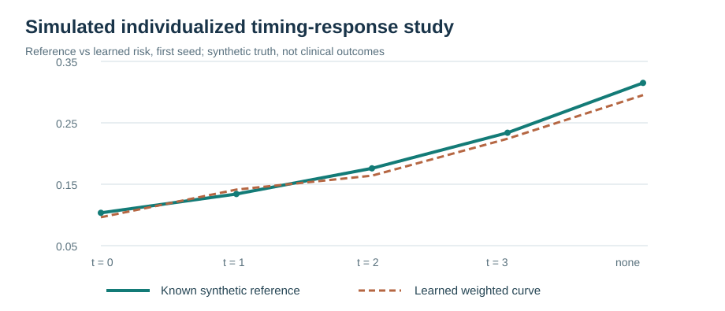

# GPU-Accelerated Causal Machine Learning

[](https://doi.org/10.5281/zenodo.23530461)

**Decision-time reliability · Synthetic treatment-timing experiments · Measured CUDA inference**

> **Status: early research-software prototype.** Supports a Ph.D. research plan on the causal effects of antibiotic initiation timing in sepsis and its GPU-computing evaluation. This repository contains **completed, carefully scoped pilot experiments**, not a validated antibiotic-timing policy, medical product, or a novel clinical effect estimate.

[Research architecture](docs/architecture.md) · [Verified experimental evidence](reports/research-evidence.md) · [Original executed Tesla T4 notebook](experiments/colab-t4/README.md) · [Methods and limitations](docs/research-traceability.md) · [Data and rights](RIGHTS_AND_LICENSES.md)

## Research question and evidence

**Scientific question:** For a patient with suspected sepsis at a defined ED decision time, how might the risk associated with delaying the first IV antibiotic administration vary with information available **at that time**, and how can repeated causal-model stress tests be made computationally practical?

The intended dissertation / NVIDIA fellowship contribution is a **decision-time robustness and computation framework**: specify treatment contrasts first, check temporal eligibility and causal assumptions, estimate and stress-test timing-response effects, then evaluate matched CPU/CUDA workloads at valid statistical fidelity.

The repo is **supporting evidence for this proposed workflow**, not an implementation of its complete clinical system.

| Evidence already available | Verified scope | Not demonstrated |
| --- | --- | --- |
| **ED time audit** | Public 100-person MIMIC-IV-ED Demo; **222 ED stays** and **1,038 vital-sign rows** | Treatment effects or actual feature-availability times |
| **Synthetic counterfactual baseline** | Patient-disjoint PyTorch experiment; **PEHE-RMSE 0.287** vs **0.641 Ridge** (three seeds) | Real-patient effects or dynamic clinical regimes |
| **Synthetic timing-response curves** | Five simulated treatment-start options; **IPW mean curve RMSE 0.0381** vs **0.1989 naive** (three seeds) | Patient-specific safe antibiotic delay |
| **Published toy reproduction** | Re-executed authors' *Off by a Beat* **100-run synthetic toy**, reproducing its stored values | Full sepsis experiment or independent method discovery |
| **Tesla T4** | Identical-weight synthetic inference **11.50× CUDA/CPU** at 160,000 × 5 options | Full GPU-accelerated clinical causal-analysis pipeline |

[Detailed research-to-code evidence table →](docs/research-traceability.md)


*Diagram convention: green marks a completed, **scope-limited** experiment; blue marks planned work. It is a research roadmap, not an end-to-end validated clinical pipeline.*

## Measured GPU experiment

An **executed Google Colab NVIDIA Tesla T4 session (21 October 2026)** compared CPU and CUDA inference using identical trained model weights. Median timings below were computed from **three repetitions per workload**; transfer of input and output data was counted, while model transfer and warmup were excluded.



| Synthetic inference workload | CPU median | CUDA median | CPU / CUDA | Max prediction difference |
| --- | ---: | ---: | ---: | ---: |
| 3,200 simulated people × 5 options | 26.820 ms | 1.259 ms | **21.30×** | 1.19 × 10⁻⁷ |
| 160,000 simulated people × 5 options | 237.679 ms | 20.659 ms | **11.50×** | 1.19 × 10⁻⁷ |

A separate **end-to-end training and evaluation** timing comparison gave CPU 1.592 s vs CUDA 1.199 s (1.33×), but the two devices **trained independent weights**; this is preliminary, not a parity-controlled speedup. The single Colab session does not establish generalized GPU performance. **These experiments use synthetic data only and do not measure antibiotic effects in real patients.**

[Executed notebook + source files](experiments/colab-t4/README.md) · [Hardware, timing protocol, and limitations](reports/colab-runs/2026-10-21-t4/README.md) · [Machine-readable measurements](reports/colab-runs/2026-10-21-t4/colab-t4-2026-10-21.json)

## Causal-ML feasibility studies

### Individualized *synthetic* timing-response curves

A controlled simulator provides five timing interventions and known counterfactual truth **for evaluation only**. Two neural estimators are trained on factual outcomes; no oracle outcomes are used for fitting. The IPW learner attained **0.038054 mean curve RMSE** versus **0.041096 unweighted** and **0.198853 naive group means** across three independent synthetic seeds. Simulator-provided treatment probabilities would **not** be known in real observational EHR data.



[Method, assumptions and observed results](docs/personalized-risk-curve-experiment.md) · [GitHub Actions evidence](https://github.com/Farshidbagheri/GPU-Accelerated-Causal-ML/actions/runs/39556722065)

### Independent sequential-data and temporal-audit groundwork

- **Synthetic PyTorch S-learner:** mean one-step PEHE-RMSE **0.287209** compared with **0.640825 Ridge** and **2.912222 naive** on a fixed, synthetic data-generating process. It is **not** a T4, VTDNet, or G-Transformer paper reproduction. [Model evaluation](reports/research-evidence.md) · [Visual comparison](figures/synthetic_counterfactual_pehe.svg).
- **Temporal-alignment demonstration:** original authors' *Off by a Beat* toy notebook re-executed across **100 synthetic runs**; stored simulated policy values **3.343** (original) and **9.878** (shifted) reproduced. No real clinical policy or mortality outcome was reproduced. [Replication record](reports/temporal-alignment.md) · [Toy-results plot](figures/offbyabeat_authors_toy_policy_values.svg).
- **Public ED Demo documentation audit:** at hypothetical 30/60/120-minute arrival cutoffs, **868 / 815 / 693 of 1,038** vital-sign records had later **charttime** timestamps. This is a descriptive documentation-time count; it **cannot** establish clinical data leakage, antibiotic administration, or treatment effects. [Audit details](reports/ed-timing-audit.md) · [Measured figure](figures/documentation_cutoff_audit.svg).

## Reproduce and audit

**Basic CPU-only data audit** (Python 3.11 supported):

```bash
python -m pip install -r requirements.txt
python scripts/verify_public_demo.py
python scripts/check_research_metadata.py
python -m pytest -q tests/test_timing_audit.py tests/test_run_pilot.py
python scripts/run_pilot.py --data data --out results --offsets 30,60,120
```

The separately scoped PyTorch experiments install their scientific dependencies through reproducible [GitHub Actions workflows](.github/workflows/). For the **measured GPU run**, open the [original Colab notebook](experiments/colab-t4/NVIDIA_Causal_ML_CPU_CUDA_Benchmark.ipynb) in Google Colab with CUDA hardware; results depend on the allocated GPU and runtime. The recorded notebook is not identical to the earlier GitHub CPU implementation.

**Documentation and reproducibility checks run automatically in GitHub Actions** to detect inconsistent evidence metadata, broken internal links, and altered public-demo checksums. [CI definition](.github/workflows/test.yml).

## Repository map

| Location | Purpose |
| --- | --- |
| [`data/`](data/README.md) | Official public ED Demo data, original ODbL license and checksum manifest |
| [`experiments/colab-t4/`](experiments/colab-t4/README.md) | Executed GPU notebook, actual Python source and runtime output |
| [`src/`](src/) and [`scripts/`](scripts/) | Own prototype estimators, audits, execution tools and integrity checks |
| [`reports/`](reports/) and [`figures/`](figures/) | Recorded numeric evidence and figures generated from real runs/simulations |
| [`models/`](models/README.md) | Third-party method provenance and reproduction status; **not** copied model source |
| [`docs/`](docs/research-traceability.md) and [`tests/`](tests/) | Scientific boundaries, target architecture and regression tests |

## Data, licensing and citations

**Dataset:** Johnson, A., Bulgarelli, L., Pollard, T., Celi, L. A., Horng, S., & Mark, R. (2023). *MIMIC-IV-ED Demo v2.2*. PhysioNet. [DOI: 10.13026/jzz5-vs76](https://doi.org/10.13026/jzz5-vs76). The six bundled, byte-preserved public demonstration tables are licensed under **Open Data Commons ODbL 1.0**, **not MIT**. The [original license](data/LICENSE.txt) and checksums are retained. The **credential-restricted full MIMIC-IV / MIMIC-IV-ED datasets are not included**.

**Original software and its accompanying original documentation:** [MIT License](LICENSE), copyright © 2026 Farshid Bagheri Saravi. **This MIT grant does not cover the independently copyrighted MIMIC-IV-ED Demo data**, which remain [ODbL 1.0](data/LICENSE.txt), or unbundled third-party code (original authors' licenses apply). The Zenodo software-record license should read **MIT**, while the dataset's original ODbL attribution and license are retained. See [file-by-file rights](RIGHTS_AND_LICENSES.md).

**Citation:** The first research-software archive is **v0.1.0**, [version-specific DOI **10.5281/zenodo.23530462**](https://doi.org/10.5281/zenodo.23530462) ([GitHub Release](https://github.com/Farshidbagheri/GPU-Accelerated-Causal-ML/releases/tag/v0.1.0)). For the evolving project across future releases, use the [concept DOI **10.5281/zenodo.23530461**](https://doi.org/10.5281/zenodo.23530461). [`CITATION.cff`](CITATION.cff) contains the software citation metadata. The badge at the top links to the concept DOI. A DOI preserves a citable software release; it does **not** certify treatment safety, scientific novelty or causal validity. **The frozen v0.1.0 archive predates this README DOI-badge update**, which is a normal post-archive change on `main`.

## Research outlook

**From reproducible prototypes to reliable, scalable causal evidence.** The next phase will connect decision-time treatment definitions, uncertainty-aware timing-response analyses, and matched CPU/CUDA evaluation—testing not only **how fast** an analysis runs, but also **when its conclusions can be trusted**.

*Farshid Bagheri Saravi · Case Western Reserve University*
