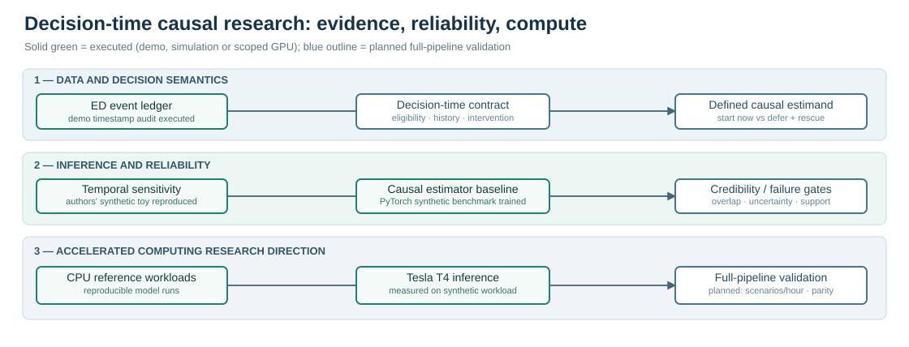
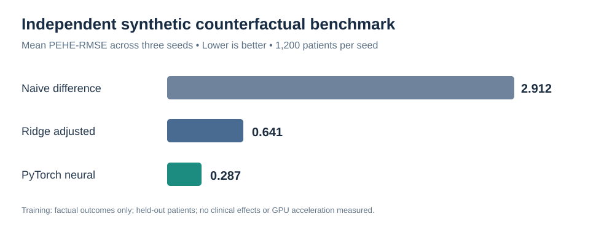

# GPU-Accelerated Causal Machine Learning

**Decision-time reliability and computational scalability for longitudinal treatment-effect research**

This repository supports doctoral research on the causal effects of antibiotic initiation timing in sepsis. Its engineering goal is to make repeated counterfactual analyses **auditable, statistically credible, and eventually more computationally efficient**, rather than to automate antibiotic prescribing.




**Research-to-code traceability:** [Which elements of the antibiotic-timing dissertation are implemented, simulated, or still proposed](docs/research-traceability.md).

## Research architecture

1. **Clinical decision contract** — define eligible patients, landmark time, available history, treatment strategies, outcome horizon, and identification assumptions.
2. **Temporal evidence audit** — distinguish event, charting, result-availability and administration timestamps before building predictors.
3. **Causal modeling** — evaluate factual outcomes and counterfactual estimators with controlled simulations and transparent comparators.
4. **Reliability gates** — test overlap, temporal sensitivity, known-truth error, uncertainty and failure conditions.
5. **Computational profiling** — benchmark the same validated workload on CPU and CUDA, accounting for training, memory, data transfer and numerical agreement.

The first four components are represented by **partial experiments** below. Matched CUDA benchmarking is a **planned experiment**, not an achieved speedup. See [technical architecture](docs/architecture.md).

## Results supported by executed code

| Evidence | Experiment and interpretation | Verification |
| --- | --- | --- |
| **Reproduced prior work** | Re-ran 100 synthetic experiments from the authors' *Off by a Beat* notebook (2026). Simulated policy values **3.343 vs 9.878** match its stored outputs. This is **not** the paper's clinical experiment. | [Workflow](https://github.com/Farshidbagheri/GPU-Accelerated-Causal-ML/actions/runs/39530437176) |
| **Independent causal-learning baseline** | PyTorch outcome model trained on three synthetic, patient-disjoint longitudinal datasets; mean **PEHE-RMSE 0.287** versus **0.641** for adjusted Ridge and **2.912** for a naive comparator. These are synthetic one-step treatment effects, **not** clinical antibiotic effects. | [Workflow](https://github.com/Farshidbagheri/GPU-Accelerated-Causal-ML/actions/runs/39531676558) |
| **Real-data documentation audit** | Open MIMIC-IV-ED Demo (100 deidentified patients, **222 ED stays**, **1,038** vital-sign records). Analyzed documentation timing against hypothetical decision cutoffs, **not** trained-model leakage or efficacy. | [Workflow](https://github.com/Farshidbagheri/GPU-Accelerated-Causal-ML/actions/runs/39542809955) |
| **Model integration assessments** | VTDNet upstream architecture: reduced CPU forward/backward smoke check only. T4: paper-level reproduction blocked by missing/incompatible original preprocessing inputs. | [Model registry](models/README.md) |



**Important boundary:** No CUDA speedup or clinically identified effect of delayed antibiotic administration has been measured in this repository. Full T4 and VTDNet paper metrics have **not** been reproduced.

## Repository layout

```text
.github/workflows/     Continuous integration and separately scoped experiments
data/                  Open MIMIC-IV-ED Demo tables + original license/checksums
docs/                  Architecture, reproducibility, experiment matrix, data governance
figures/               Editable research diagrams and result summaries
models/                External-method registry and scope of reproduction
reports/               Auditable aggregate results, protocols and machine-readable summaries
scripts/               Data integrity, timestamp audit and paper-integration checks
src/                   Temporal data validation and longitudinal causal benchmark
tests/                 Patient-split, timing and implementation unit tests
```

### Quickstart: verified open-data audit

Requires Python 3.11; does not need a GPU.

```bash
python -m pip install -r requirements.txt
python scripts/verify_public_demo.py
python -m pytest -q tests/test_timing_audit.py tests/test_run_pilot.py
python scripts/run_pilot.py --data data --out results --offsets 30,60,120
```

### Run model benchmarks

- [Causal estimator code](src/longitudinal_synthetic_benchmark.py) · [CPU-run CI](.github/workflows/causal-benchmark.yml)
- [Published temporal-alignment toy reproduction](scripts/reproduce_offbyabeat_toy.py) · [CI](.github/workflows/reproduce-offbyabeat-toy.yml)
- [Upstream VTDNet architecture smoke](scripts/vtdnet_upstream_smoke.py) · [CI](.github/workflows/vtdnet-architecture.yml)
- [Experiment evidence](reports/research-evidence.md) · [Experimental scope matrix](docs/experiment-matrix.md)

Separate model jobs install their own dependencies. Standard hosted GitHub Actions runners here provide CPU; they are **not** evidence of GPU execution.

## Data, licenses and attribution

The checked-in ED data are the **public MIMIC-IV-ED Demo v2.2**, not the credential-restricted full dataset. Source: Johnson et al. (2023), PhysioNet, [DOI 10.13026/jzz5-vs76](https://doi.org/10.13026/jzz5-vs76), **Open Data Commons Open Database License 1.0**. Source files and hashes are preserved; [CI checks the distribution hashes](https://github.com/Farshidbagheri/GPU-Accelerated-Causal-ML/actions/runs/39542809361).

[Data and licensing](docs/data-and-licensing.md) · [Reproducibility protocol](docs/reproducibility.md)

**Data folder:** [source, table descriptions and usage boundaries](data/README.md). **External models:** [source links and exact validation status](models/README.md).\n\n**Code license:** No open-source software license has been assigned to the original Python code. The data's ODbL license does not automatically license that code. Do not upload credential-restricted data, identifiable records, secrets, or unapproved institutional data here.

**Research:** Farshid Bagheri Saravi, Case Western Reserve University.
