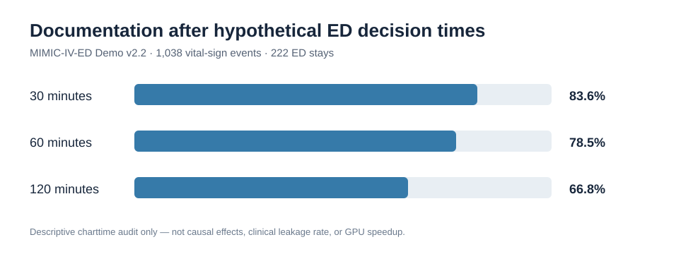

# MIMIC-IV-ED Demo — Decision-time documentation audit

**Source:** MIMIC-IV-ED Demo v2.2, publicly released, deidentified.  
**Reproduction:** [GitHub Actions run 39519816023](https://github.com/Farshidbagheri/GPU-Accelerated-Causal-ML/actions/runs/39519816023), commit `7f90eeb8c9eeeafc941f0c9197537209e70c8bed`.  
**Software:** Python/pandas; **5 / 5 unit tests passed**; an actual audit of the repo's uploaded demo tables ran to completion.

## Observed counts

- **222** distinct ED stays (**206** have vital-sign rows).
- **1,038** documented vital-sign events.
- **69** vital-sign events have documentation timestamps outside the recorded ED stay window.
- **796** deduplicated Pyxis documentation entries over **176** ED stays (dispensation, **not confirmed medication administration**).

| Hypothetical cutoff after ED arrival | Documentation on/before cutoff | Documentation after cutoff | Fraction of all documented vital-sign rows after cutoff |
| --- | ---: | ---: | ---: |
| 30 minutes | 170 | 868 | 83.6% |
| 60 minutes | 223 | 815 | 78.5% |
| 120 minutes | 345 | 693 | 66.8% |



## Scientific interpretation

This is a descriptive check of retrospective EHR record timing. It **does not show** that 83.6%, 78.5%, or 66.8% of an actual model's features leaked. No prediction model was trained. The cutoffs are hypothetical and not patient-specific antibiotic decisions; `charttime` is documentation time, not verified result availability. The 69 timestamps outside ED windows are included in the above denominators and require further investigation.

**Not established:** clinical treatment effects, safe antibiotic delays, patient mortality, GPU acceleration, improvement over T4/G-Transformer, or causally identified benefits. This is a software/data-quality milestone, **not** a reproduction of any referenced paper.

## Reproduce

```bash
python -m pip install -r requirements.txt
python -m pytest -q
python scripts/run_pilot.py --data data --out results --offsets 30,60,120
```

The action creates `results/aggregate_audit.json` as an artifact. This tracked report is an aggregate-only snapshot of those validated run logs; it includes no person-level rows.

**Citation:** MIMIC-IV-ED Demo v2.2, PhysioNet, DOI: [10.13026/jzz5-vs76](https://doi.org/10.13026/jzz5-vs76).
