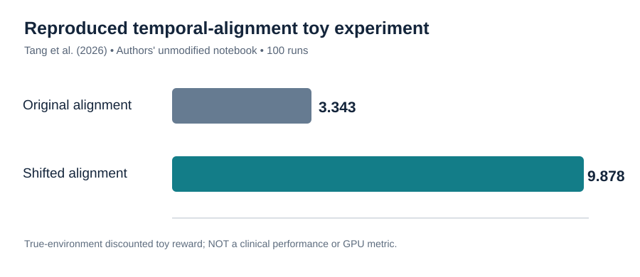

# Reproduction report: *Off by a Beat* (2026) — authors' synthetic experiment

**Verified execution:** [GitHub Actions, successful run](https://github.com/Farshidbagheri/GPU-Accelerated-Causal-ML/actions/runs/39530437176)  
**Paper:** Tang et al., *npj Digital Medicine* 9, 360 (2026), [DOI 10.1038/s41746-026-02625-2](https://doi.org/10.1038/s41746-026-02625-2).  
**Exact upstream source:** [authors' Toy_Problem.ipynb](https://github.com/shengpu-tang/RL-Off-by-a-Beat/blob/2f3e58c8a9186f68b22b0ab5b82c6f9366968ac6/synthetic/Toy_Problem.ipynb); pinned upstream SHA `2f3e58c8a9186f68b22b0ab5b82c6f9366968ac6`.

## Protocol and observed results

The runner executes original, **unmodified Python source cells** from the authors' notebook, not a reimplementation. For the *All Experiments* section, cells `6,7,8,29,38,39,40,41,43,45,46,48` implement **100 randomized runs**, each using **100 synthetic episodes of 100 time steps**. Policies use two states and two actions and are evaluated under the author's known simulator dynamics with discount 0.9.

| Result | Original temporal alignment | Shifted alignment |
| --- | ---: | ---: |
| Average policy, state 0: probability action 1 | 0.06 | 1.00 |
| Average policy, state 1: probability action 1 | 0.83 | 1.00 |
| Mean discounted policy value in true toy simulator | **3.3433734932** | **9.8780487796** |

**Agreement with original notebook:** the values **match the saved outputs of the authors' cell 49 exactly** (within floating-point tolerance). The corresponding average policies also match its saved cell 47.

- Runs where the two policies differed in at least one state: **94 of 100**.
- The separate 100-episode *illustrative single run* yielded matching policies (zero disagreement). This illustrates why one short smoke test is not sufficient.
- This is **successful reproduction of the authors' synthetic toy sweep**, not of the article's full clinical findings.

## Interpretation for this project's causal research

The experiment demonstrates that temporal-index choices can substantially alter a learned policy and its **simulation** reward, even when the same trajectories are used. The result motivates decision-time checking in downstream longitudinal causal studies. The result **does not** estimate antibiotic effects, medical safety, sepsis mortality or any GPU performance improvement.

### Replicate

The [dedicated GitHub workflow](../.github/workflows/reproduce-offbyabeat-toy.yml) checks out the authors' repository at the pinned commit. It installs `numpy`, `gymnasium`, and `tqdm`; runs `scripts/reproduce_offbyabeat_toy.py --mode full-toy-sweep`; and uploads JSON output as a GitHub Actions artifact. It is scoped to code changes affecting this experiment or manual dispatch, rather than retraining on every unrelated commit.

**Next scientific gate:** independently evaluate whether temporal availability assumptions in antibiotic-start causal estimation align with these findings. Do not transplant policy-value numbers from this toy to real EHRs.
